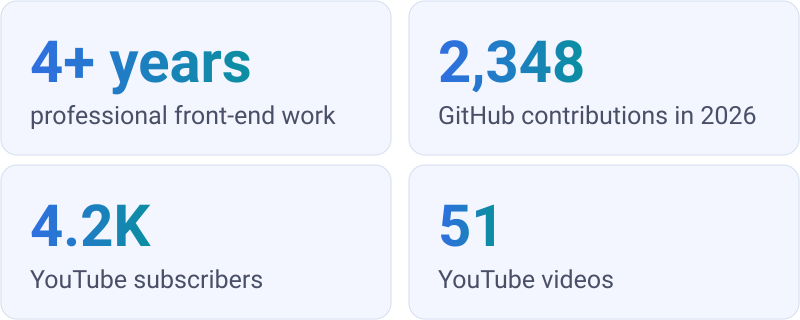
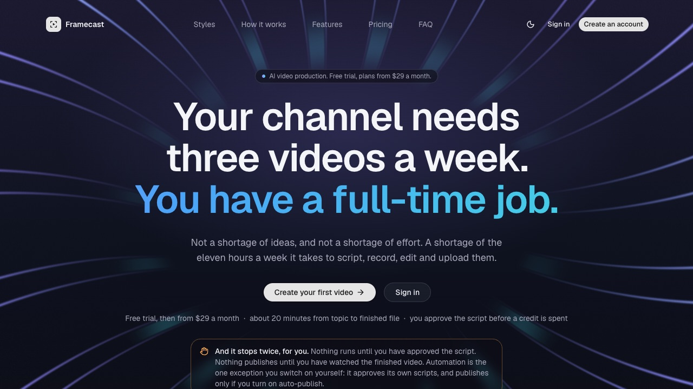
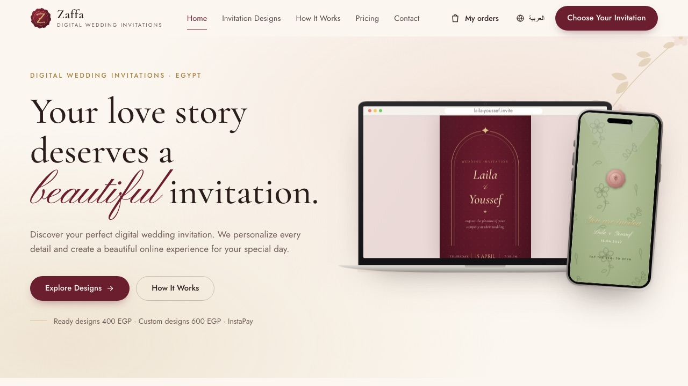
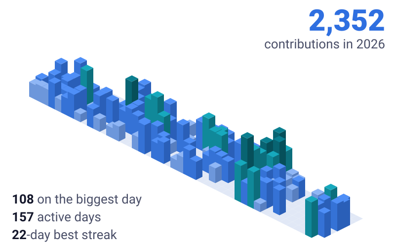

<picture>
  <source media="(prefers-color-scheme: dark)" srcset="assets/hero-dark.svg">
  <source media="(prefers-color-scheme: light)" srcset="assets/hero-light.svg">
  
</picture>

I'm a front-end engineer with 4+ years of experience building web products with **TypeScript, React and Next.js**. At work I lead front-end development at **[Axis Pay](https://www.axisapp.com/)**. Outside work I build my own products, like [Framecast](https://framecasts.com) and [Zaffa](https://zaffa-digital-invitation.vercel.app/en), and I make Egyptian-Arabic tech videos on YouTube.

**[LinkedIn](https://www.linkedin.com/in/haleem-rafat-7a3b30216/)** · **[YouTube](https://www.youtube.com/@haleemrafat)** · **[X](https://x.com/RafatHaleem)** · **[Framecast](https://framecasts.com)**

<picture>
  <source media="(prefers-color-scheme: dark)" srcset="assets/stats-dark.svg">
  <source media="(prefers-color-scheme: light)" srcset="assets/stats-light.svg">
  
</picture>

Numbers as of November 2026.

## Featured projects

### Framecast

An AI video studio for YouTube. You type a topic and it takes the video through eight stages: script, narration, footage, render, metadata, thumbnail, shorts and upload.

<picture>
  <source media="(prefers-color-scheme: dark)" srcset="assets/pipeline-dark.svg">
  <source media="(prefers-color-scheme: light)" srcset="assets/pipeline-light.svg">
  
</picture>

- You approve the script before it runs and watch the final video before it publishes.
- A daily schedule can make videos automatically, and reels are cut from every long video.
- The cost of every generation is recorded against the video that used it.

`Next.js` `React` `TypeScript` `PostgreSQL` `Prisma` `Vercel AI SDK` `FFmpeg` `Docker`

**[Visit framecasts.com →](https://framecasts.com)**

### Zaffa

Digital wedding invitations for Egypt. Couples browse designs and order one, and guests get a single link that opens the invitation on their phone.

- Bilingual site in Arabic (RTL) and English.
- Each invitation design is its own template, shown as a real preview on a phone.

`Next.js 16` `React 19` `TypeScript` `Tailwind CSS 4`

**[Visit the site →](https://zaffa-digital-invitation.vercel.app/en)** · **[Source code](https://github.com/Haleem-rafat/zaffa-Digital-Invitation)**

### AI Video Studio

A local studio that makes YouTube videos, plus Instagram reels and posts for marketing clients.

- Goes from a topic to a script, voice, pictures and a finished video.
- Timeline editor with a live preview, and styles like motion graphics, whiteboard, explainer and product versus.

`TypeScript` `React` `Three.js` `Vercel AI SDK` `MCP`

**[Source code →](https://github.com/Haleem-rafat/ai-video-studio)**

### Real-Time Trading Dashboard

A full-stack coding challenge that simulates a market feed and shows it live.

- Streams 6 tickers every 500ms over Socket.IO to an interactive chart.
- Price alerts, a dark/light terminal UI, and API docs with Swagger.

`React 19` `NestJS 11` `Socket.IO` `Redis` `Recharts` `Docker`

**[Source code →](https://github.com/Haleem-rafat/real-time-trading-dashboard)**

### Kleano

A mobile car wash platform: customers book a wash, a biker comes to the car, and an admin team runs it all from a dashboard. I work on the web apps, the dashboard and the Flutter biker app.

`Next.js` `React` `Tailwind CSS` `shadcn/ui` `Flutter` `BLoC`

**[Source code →](https://github.com/Haleem-rafat/kleano)** · **[Biker app](https://github.com/Haleem-rafat/kleano/tree/main/biker-app)**

## Experience

<picture>
  <source media="(prefers-color-scheme: dark)" srcset="assets/timeline-dark.svg">
  <source media="(prefers-color-scheme: light)" srcset="assets/timeline-light.svg">
  
</picture>

**Senior Front-end Engineer · [Axis Pay](https://www.axisapp.com/)** · Oct 2024 to present

- Lead front-end development and mentor the team through code reviews, technical guidance and documentation.
- Moved the Axis Pay website from Next.js 13 to Next.js 15, including breaking changes and performance work.
- Planned the upgrades from React 18 to 19 and from Ant Design v5 to v6.
- Added Sanity CMS so the marketing team can update content without a developer.
- Added end-to-end tests with Playwright and moved the codebase to an Atomic Design system.

**Front-end Engineer · Spiritude** · Apr 2022 to Oct 2024

- Built **[Fundr](https://getfundr.ai/)**, a GCC fundraising platform, with a dnd kit Kanban board and large dynamic forms using React Hook Form and Yup.
- Built **Allatre**, an e-commerce bidding platform with Firebase OAuth, Socket.IO chat and Stripe payments.
- Designed and built **Zabnh Admin**, a full admin dashboard, on my own.
- Moved data fetching from `useEffect` to React Query and SWR to cut re-renders, and added multi-language support with i18next.

## My 2026 in code

Every building is a real day of my GitHub contributions this year. The taller it is, the more I shipped that day.

<picture>
  <source media="(prefers-color-scheme: dark)" srcset="assets/city-dark.svg">
  <source media="(prefers-color-scheme: light)" srcset="assets/city-light.svg">
  
</picture>

## Tech stack

**Front end**

<picture>
  <source media="(prefers-color-scheme: dark)" srcset="assets/stack-frontend-dark.svg">
  <source media="(prefers-color-scheme: light)" srcset="assets/stack-frontend-light.svg">
  
</picture>

**Back end**

<picture>
  <source media="(prefers-color-scheme: dark)" srcset="assets/stack-backend-dark.svg">
  <source media="(prefers-color-scheme: light)" srcset="assets/stack-backend-light.svg">
  
</picture>

**Mobile**

<picture>
  <source media="(prefers-color-scheme: dark)" srcset="assets/stack-mobile-dark.svg">
  <source media="(prefers-color-scheme: light)" srcset="assets/stack-mobile-light.svg">
  
</picture>

**Testing and tools**

<picture>
  <source media="(prefers-color-scheme: dark)" srcset="assets/stack-tools-dark.svg">
  <source media="(prefers-color-scheme: light)" srcset="assets/stack-tools-light.svg">
  
</picture>

| Area | Tools |
| --- | --- |
| **UI** | Ant Design, shadcn/ui, Radix UI, Mantine, Framer Motion |
| **Data and forms** | React Query, SWR, Redux Toolkit, React Hook Form, Formik, Yup, Zod |
| **Features** | Socket.IO, i18next, dnd kit, Stripe, Sanity, Recharts |
| **Testing** | Playwright, Jest, React Testing Library |
| **AI and video** | Vercel AI SDK, FFmpeg |

## On YouTube

I review tech and explain how it works on **[my channel](https://www.youtube.com/@haleemrafat)**. The videos are in Egyptian Arabic. Recent ones:

- [Every iPhone from 2007 to 2026](https://www.youtube.com/watch?v=BS_MiL_RAl4)
- [KingSmith WalkingPad G1 review](https://www.youtube.com/watch?v=hd0Nq02l3Zc)
- [iPhone Duo vs iPhone 18 Pro](https://www.youtube.com/watch?v=J0TMcD2OpMo)

## More work

- **[ISO Kitchen](https://www.isokitchensa.com/en)**: front end for a kitchen manufacturer's website in Saudi Arabia.
- **[Tadarab Client Web](https://github.com/Haleem-rafat/tadarab-client-web)**: web client for the Tadarab learning platform, built with Next.js 15.
- **[MovieHub](https://github.com/Haleem-rafat/movies-next-15)**: browse and search movies and TV series, built with Next.js 15.
- **[3D Kitchen Editor](https://github.com/Haleem-rafat/3D-kitchen-models)**: change a kitchen's colors and lighting in 3D, built with Three.js.
- **[Digital Invitations](https://github.com/Haleem-rafat/Digital-Invitations)**: mobile-first wedding invitation with RSVP and add-to-calendar, built with React and Vite.
- **[Contacts Management](https://github.com/Haleem-rafat/contacts-management-client-web)**: contacts dashboard with filtering, search and create/edit, built with React and Redux Toolkit.

Stack icons from [skill-icons](https://github.com/tandpfun/skill-icons) (MIT).
